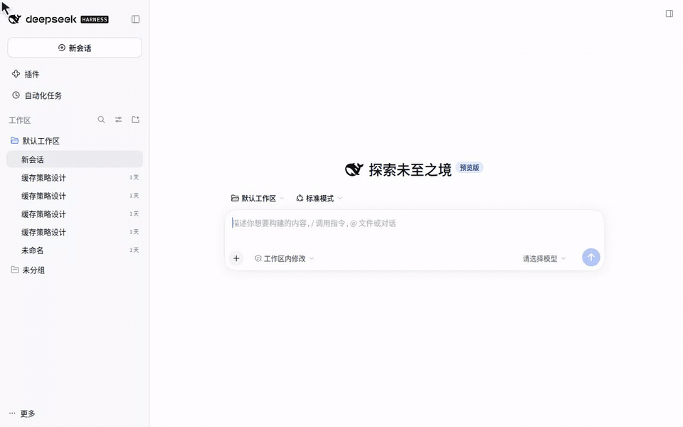

[中文](#cn-050) | [English](#en-050)

> 审稿草案 / Editorial draft：尚未发布，最终文字待审核，技术验收仍为 BLOCKED。

本版本是一次围绕本地 Agent 历史引用与接续工作流程的重大更新，汇总自 `v0.4.4` 以来的变更：来源目录从 14 类扩展到 29 类，升级本地引用工具协议，并新增正文预览、搜索、图片读取、会话导入和实验性交接摘要。

<h3 id="cn-050">新增功能</h3>

- 来源目录扩展至 29 类，新增 Antigravity、Kilo Code、ChatGPT 导出、WorkBuddy、Qwen Code、Continue、Cline、Goose、DSH4、Zed、Crush、TeleAgent、Trae Work、Mistral Vibe 和 DSH。
- 内置来自 Chat Import 0.26.1 的只读扫描与解析能力，统一发现更多格式的历史。无需安装独立 Chat Import 即可搜索和引用；导入与交接摘要才使用独立插件。
- 本地引用在发送时自动附上正文预览，让模型开始回答前就能看到历史上下文；正文、工具记录、图片目录分开展示。
- 重做本地会话工具协议：reference_list 专门发现本地会话；reference_read 通过 ref 定位，使用 part=messages/tools/images 选择内容，以 from/maxItems 分页，返回统一的 revision/items/next。
- 新增 reference_search，支持在本地会话正文或工具文本中按区分大小写的字面关键词搜索，每条记录返回首个匹配片段；命中位置可直接交给 reference_read 继续读取。
- 新增 reference_image，按图片 ID 取回原生图片内容，模型可以直接看图；每次一张、最大 10 MiB，需要可恢复的图片数据及视觉模型。
- 多条本地引用按预处理批次共享文本预算，默认 16 KiB，剩余上下文可进一步降低它；预览保留最近连续尾段，长消息提供可继续读取的前缀。每次本地工具文本结果另受默认 16 KiB 上限限制。
- 新增可读的 dsh-local 定位与完整引用块，支持同机重启后续读和跨会话复制。每次读取检查当前来源开关、允许目录及会话身份，不再要求逐会话引用授权；关闭来源后旧引用也不能新读取，已注入的历史不会自动撤回。
- Enter 引用，Tab 进入会话操作：通过 Chat Import 导入完整历史并打开目标会话，显示导入状态；操作失败在菜单中保留原因并支持重试。
- Claude Code 与 Codex 新增实验性交接摘要，将历史工作的摘要放入当前输入框，便于接着做；默认关闭，不自动发送。
- 新增“会话导入与交接”设置：导入入口、摘要入口及操作确认可分别配置，默认显示导入、关闭摘要并保留确认。
- 新增 Chat Import 状态检查与显式安装/升级入口，兼容已有独立版本；保留用户禁用决定，升级失败可重试，停用引用插件不移除独立 Chat Import。
- 新增离线可看的版本功能卡与 GIF 演示、上一页/下一页导航，以及首次进入该版本插件设置时的介绍；关闭介绍与隐藏菜单入口分别记录。

### 体验优化

- 本地长记录使用明确的 next 接续位置，可跨消息内部继续读取；工具、图片列表可按所属消息过滤，列表版本与正文版本分开校验。
- 每条用户消息后的多份本地引用合并为一个背景区块；固定工具说明不再逐页重复，显示元数据与正文分离。
- 功能介绍卡片随界面语言显示中文或英文，未提供英文的卡片回退到原文。

- DSH 会话候选区分当前任务的子 Agent 会话并优先展示，补齐冷会话标题信息、过滤已确认的空会话，改进时间与名称展示。
- 文件浏览新增面包屑返回导航；下钻目录时隔离其他来源结果；文件引用支持通过宿主资源面板打开，目录继续保持 Tab 浏览、Enter 引用。
- 完善多个逗号分隔快捷词和跨来源共享快捷词的匹配，保留 codex 等具体来源别名的定向筛选。
- 后台检查会话正文可用性，隐藏已确认无正文的记录；未知结构、读取异常和超出检查预算的条目继续保留，文件变化后重新检查。
- 扫描改为独立子进程并增加短期缓存、请求合并和来源级警告，设置中可查看检测到的路径与会话数量。
- 插件启动后进行轻量连接检查；网页菜单在同步操作旁显示检查中、可用或异常状态，具体列出 OpenCLI、Bridge、适配器及扩展问题，未就绪时阻止无效同步。
- OpenCLI 2.0.0 随插件作为固定依赖安装，更新统一随插件交付；适配 JSON 管理输出、扩展兼容状态与新版 Bridge 生命周期，网页适配器更新至 0.2.3。
- 补齐扩展来源图标，调整本地来源卡片与扫描状态展示；当前版本说明与远端最新版本说明分开获取，避免更新信息错位。

### 问题修复

- 修正 @ 菜单首次打开时的异步选中顺序，等待排在前面的来源完成；用户开始键鼠操作后不再自动改动选择。
- 修正下钻操作与普通搜索缓存混用、重复点击导入/摘要以及菜单刷新影响操作状态的问题，保留错误和重试入口。
- 完善 Codex 附件包装中的正文与图片、Codex/Claude 压缩检查点、Trae 消息分段，以及 Antigravity 类型化工具结果和异步结果的解析关联。
- 精简本地工具返回，正文只保留一份结构化数据，直接调用和 run_code 使用一致内容；长文本按 Unicode 码点偏移续读，不把截断当作读完。保留宿主拒绝/替换策略，来源变化时拒绝旧位置并提示刷新。
- 加强真实路径、来源开关、允许目录与会话身份校验；导入/摘要仍只接受扫描选择并保留确认流程。来源关闭、原始记录缺失、版本变化及参数错误分别返回明确错误，不放宽 DSH 沙箱。

### 其他变更

- 网页/云盘等非本地来源的列表和读取工具改名为 external_reference_list 与 external_reference_read，仍使用其 URI 协议；reference_attachment_read 保持原名。
- Chat Import 安装/升级只接受 npm 0.26.1 或更高版本，移除旧 GitHub 源码包回退；按需显式安装，不随启动自动安装。

- 建立演示、亲测、Desktop、Agent 浏览器测试四环境分工，以及真实来源验收、官方 Session Log 诊断、tgz 安装矩阵、累计报告与文案审稿流程。

#### 本地 Agent 工具协议迁移

本次重做的是历史读取接口，不是调用另一个 Agent 执行任务。旧参数不再兼容。

| 项目 | 远端 0.4.4 | 当前 0.5.0 |
| --- | --- | --- |
| 本地发现 | 通用 reference_list | 本地专用 reference_list，条目提供 ref |
| 本地读取 | uri / cursor / before / detail | ref / revision / part / from / maxItems |
| 正文结果 | 旧消息窗口 | revision、items、next；正文只出现一次 |
| 接续 | 旧 cursor | 原样将 next 放入同类操作的 from；null 表示当前范围结束 |
| 搜索 | 无专用本地搜索 | reference_search，正文与工具记录均可搜索 |
| 非本地来源 | reference_list/read | external_reference_list/read，继续使用 URI |

首次读取示意（ref 必须取自真实列表或引用；占位符不能直接执行）：

```json
{"ref":{"source":"codex","path":"<原始绝对路径>","sessionId":"<实际 ID>"},"part":"messages","maxItems":20}
```

初次从头读取 messages 时省略 revision 和 from；后续使用返回的正文 revision，并完整复制 next 到 from。part=tools/images 分别返回工具记录或图片目录；查看像素另用 reference_image，并携带数字 imageId。reference_search 的 part 可为 messages/tools，query 为区分大小写的字面子串。

上一开发草稿中的顶层 source/path/sessionId、start/limit/mode 也已删除。旧本地引用需重新选择；内容版本变化时从头刷新，不复用旧位置。列表 revision 只用于列表翻页，不能作为正文 revision。长文本 textOffset 按 Unicode 码点计数，建议复制返回位置，不自行计算。

#### 演示与已知限制




来源目录覆盖不等于全部来源均通过真实账号验收；交接摘要为实验功能。预算是保守估计，大记录解析仍可能消耗较多内存；不保存本地正文快照，后续读取依赖原文件。GIF 使用隔离演示数据，不是服务验收证据。

<h3 id="en-050">New Features</h3>

This major update covers changes since `v0.4.4`, focusing on local Agent history and continuing previous work. It expands the source catalog from 14 to 29 formats, upgrades the local reference tool protocol, and adds body previews, search, image retrieval, session imports and experimental handoff summaries.

- Expand the local-source catalog from 14 to 29 formats, adding Antigravity, Kilo Code, ChatGPT exports, WorkBuddy, Qwen Code, Continue, Cline, Goose, DSH4, Zed, Crush, TeleAgent, Trae Work, Mistral Vibe and DSH.
- Bundle read-only scanners and parsers derived from Chat Import 0.26.1. Search and reference local history without installing the independent Chat Import plugin; imports and handoff summaries use that plugin separately.
- Attach a body preview when a local reference is sent, so the model receives historical context before answering. Present body messages, tool records and image indexes separately.
- Redesign local tools: reference_list discovers local sessions; reference_read takes a ref, selects messages/tools/images with part, paginates with from/maxItems and returns revision/items/next.
- Add reference_search for case-sensitive literal search in local messages or tool text. Return the first match per record and positions that can be passed directly to reference_read.
- Add reference_image to retrieve actual historical images by ID: one image per call, up to 10 MiB, with recoverable source bytes and a vision-capable model required.
- Share a default 16 KiB text budget across local previews in a pre-step batch, reduced further by remaining context. Keep a contiguous recent tail and a resumable prefix for long messages. Local tool text results have a separate default 16 KiB cap.
- Introduce readable dsh-local locators and complete reference blocks for reuse after restarts and across conversations on the same machine. Every read checks enabled sources, allowed roots and session identity; local references no longer require per-session grants. Disabling a source prevents new reads through old references but does not retract previously injected content.
- Use Enter to reference and Tab to open conversation actions: import history through Chat Import, open the destination session and display import status. Keep actionable errors in the menu for retry.
- Add experimental handoff summaries for Claude Code and Codex, placing the summary in the current composer. Disabled by default, with no automatic send.
- Add separate settings for import actions, handoff summaries and confirmation. Defaults show imports, disable summaries and keep confirmation enabled.
- Add Chat Import status checks and explicit install/upgrade actions, reuse compatible independent installations, respect disabled states, allow retry after failure and retain Chat Import when Reference Anything is disabled.
- Add offline feature cards and GIF demonstrations, previous/next navigation and an introduction on the first visit to the installed version’s settings. Closing the dialog and dismissing its menu entry are separate actions.

### Improvements

- Resume long records using explicit next positions, including offsets inside a message. Filter tool/image listings by owning message and validate list revisions separately from content revisions.
- Aggregate local references into one background block after each user message, avoid repeating stable tool instructions on every page and separate display metadata from body text.
- Show feature cards in Chinese or English according to the interface language, with fallback to the original text when an English translation is absent.

- Prioritize and label subagent sessions belonging to the current task, refresh cold-session metadata, omit confirmed blank sessions and improve titles and timestamps.
- Add breadcrumb navigation to file browsing, isolate folder drill-down results from other sources and open file references through the host resource panel. Keep Tab for browsing and Enter for referencing folders.
- Improve matching for comma-separated shortcuts and shared shortcuts across sources while preserving provider-specific filters such as codex.
- Check transcript availability in the background and hide confirmed bodyless records. Keep unknown formats, read failures and over-budget records visible, and recheck changed files.
- Run discovery in a separate process with short-lived caching, request coalescing and source-specific warnings. Show discovered paths and session counts in settings.
- Run a lightweight connection check on startup. Show checking, ready or failure status beside Web sync actions, identify OpenCLI, Bridge, adapter and extension issues, and block sync when prerequisites are not ready.
- Ship pinned OpenCLI 2.0.0 with the plugin and update it through plugin releases. Support JSON management output, extension compatibility and Bridge lifecycle changes; update the Web adapter to 0.2.3.
- Extend source icons and refine local-source cards and scan status. Fetch installed-version notes separately from latest-version notes to avoid showing the wrong release.

### Bug Fixes

- Fix initial selection races between asynchronous @ groups; wait for earlier groups and stop automatic selection once the user interacts.
- Separate drill-down actions from ordinary search caches, prevent duplicate import/summary requests and preserve action state and retry errors across menu refreshes.
- Preserve Codex wrapper text and images, Codex/Claude compaction checkpoints and Trae message parts; correctly associate typed and asynchronous Antigravity tool results.
- Keep one structured copy of local result text for direct tools and run_code. Resume long records by Unicode code-point offset instead of treating truncation as completion. Respect host denial/replacement policies and reject stale positions after source changes.
- Strengthen enabled-source, canonical-path, allowed-root and session-identity checks. Imports/summaries still use scanned selections and confirmation. Report disabled sources, missing records, changed revisions and invalid parameters distinctly without relaxing the DSH sandbox.

### Chores

- Rename non-local listing/reading tools to external_reference_list and external_reference_read while retaining their URI protocol; reference_attachment_read keeps its name.
- Install/upgrade Chat Import from npm 0.26.1 or later only, removing the old GitHub source-package fallback. Installation remains explicit, not automatic at startup.

- Establish separate demo, user-test, Desktop and Agent-browser environments, plus real-source acceptance, official Session Log diagnosis, tgz installation checks, cumulative reporting and editorial review.

#### Local Agent tool protocol migration

This redesign reads history; it does not launch another Agent. Old arguments are not supported. Local reference_list now returns refs; reference_read accepts ref/revision/part/from/maxItems and returns revision/items/next. Non-local listing/reading moves to external_reference_list/read with its URI protocol intact.

```json
{"ref":{"source":"codex","path":"<absolute source path>","sessionId":"<actual ID>"},"part":"messages","maxItems":20}
```

Copy ref from actual results. Omit revision/from only for the initial messages read. Continue with the content revision and copy the entire next into from for the same operation; null ends that scope, not necessarily all earlier history. Read tools or image listings with part=tools/images; reference_image retrieves pixels using a numeric imageId. reference_search supports messages/tools and case-sensitive literal queries.

The previous development draft’s top-level source/path/sessionId and start/limit/mode are also removed. Reselect old local references. Restart from the beginning after content changes; list revisions cannot substitute for content revisions. textOffset counts Unicode code points; copy returned positions rather than calculating them.

#### Demos and known limitations

The GIFs above use fictional data in the real Web UI, including a simulated import; they are not live-service acceptance evidence. Catalog coverage does not mean every source has passed real-account testing. Handoff summaries are experimental. Context budgeting is conservative, large sources can still consume substantial memory, and later reads require the original files because body snapshots are not saved.

Full Changelog: [v0.4.4…1b8cf3e](https://github.com/Chael-Chael/dsh-reference-anything/compare/v0.4.4...1b8cf3e1dc09b5dbf9801c6ceb1c0f85618c45ed). 远端基线已核对；本轮文案未提交，最终发布前更新为审核通过的最终提交或标签。 Remote baseline verified; this editorial revision is uncommitted. Update the comparison to the approved final commit or tag before publication.
